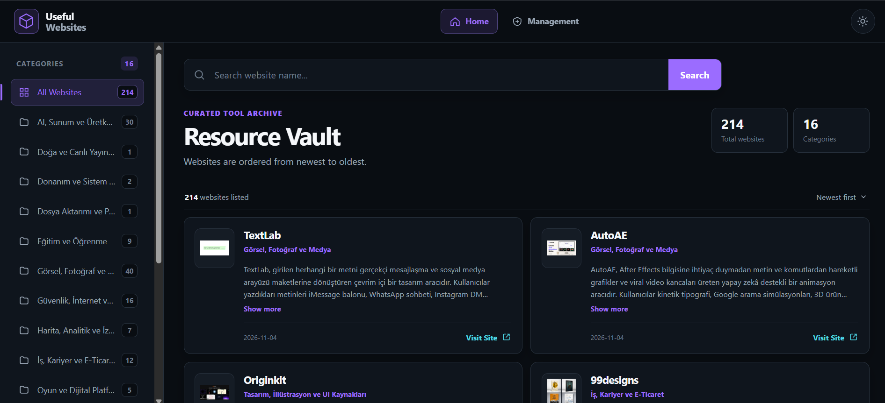
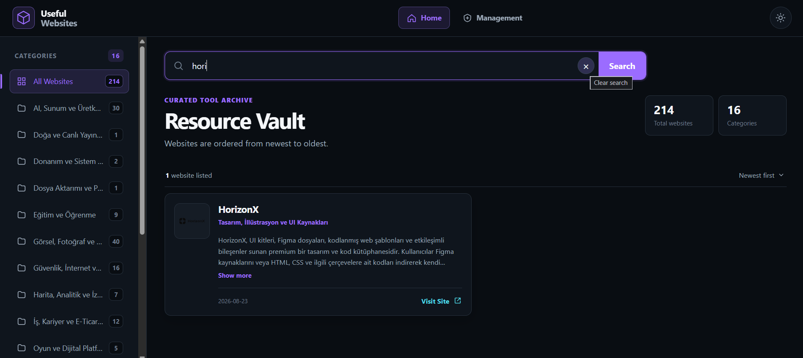
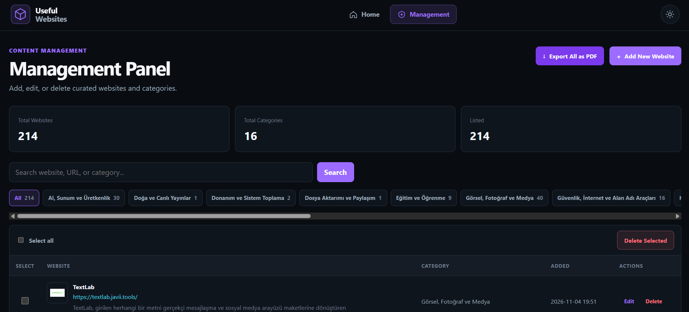
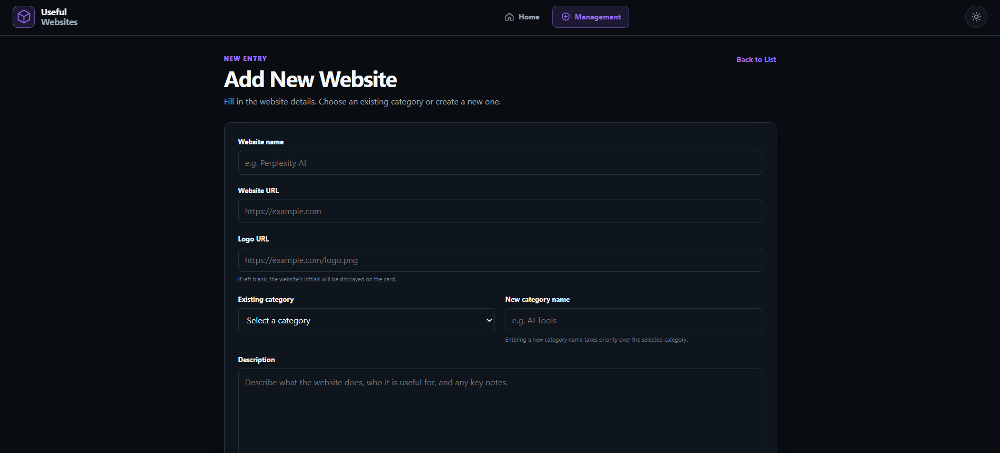

# Useful Websites

A clean, responsive ASP.NET Core MVC (.NET 10) directory web application for organizing, searching, and exporting curated useful websites by category, powered by Entity Framework Core, SQL Server, and QuestPDF.

## Screenshots

### Home — Resource Vault


### Live Search


### Management Panel


### Add New Website


## Features

- **Curated Directory (`Home`)**: Browse websites by category, search in real time with debounced live search (`Ctrl+K` / `Cmd+K` shortcut), expand long descriptions, and jump straight to any external tool.
- **Management Panel (`Admin`)**: Local-only administration panel with live search, category filtering, single and bulk delete, inline category creation on add/edit forms, and automatic logo fallback initials.
- **PDF Catalog Export**: Export all categories and websites into a clean A4 PDF archive (powered by QuestPDF) with SSRF-protected remote logo fetching and clickable hyperlinks.
- **Responsive & Theme-Aware**: Dark and light themes persisted in `localStorage` with zero flash on load, responsive across desktop, tablet, and mobile viewports.

## Tech Stack

- **Framework**: ASP.NET Core MVC (.NET 10)
- **ORM & Database**: Entity Framework Core 10 + SQL Server
- **PDF Generation**: QuestPDF (Community License)
- **Frontend**: Razor Views, vanilla JavaScript, custom CSS variables

## Getting Started

### Prerequisites

- [.NET 10 SDK](https://dotnet.microsoft.com/download)
- SQL Server / SQL Server Express / LocalDB

### Configuration

1. Clone the repository:
   ```bash
   git clone https://github.com/02-fraw/UsefulWebsites.git
   cd UsefulWebsites
   ```

2. Configure your database connection string using .NET User Secrets (recommended so `appsettings.json` stays clean):
   ```bash
   cd UsefulWebsites
   dotnet user-secrets init
   dotnet user-secrets set "ConnectionStrings:DefaultConnection" "Server=.\SQLEXPRESS;Database=UsefulWebsitesDb;Trusted_Connection=True;MultipleActiveResultSets=true;Encrypt=True;TrustServerCertificate=True"
   ```

3. Apply Entity Framework Core migrations:
   ```bash
   dotnet ef database update
   ```
   *(Or run `Update-Database` in Visual Studio's Package Manager Console.)*

4. Run the application:
   ```bash
   dotnet run
   ```

## Security Practices

- Localhost-only access guard (`LocalOnlyAdminFilter`) restricting the Admin panel to local development requests.
- Automatic anti-forgery token validation (`[AutoValidateAntiforgeryToken]`) with `HttpOnly` and `SameSite=Strict` cookies.
- SSRF-protected logo fetcher in PDF export (HTTPS-only, public IP verification, no redirects, 512 KB cap, raster magic-byte verification).
- Parameterized EF Core LINQ queries and strict ViewModel binding.
- HTTP security headers (`Content-Security-Policy`, `X-Content-Type-Options`, `X-Frame-Options`, `Referrer-Policy`, `Permissions-Policy`, `Cross-Origin-Opener-Policy`).
